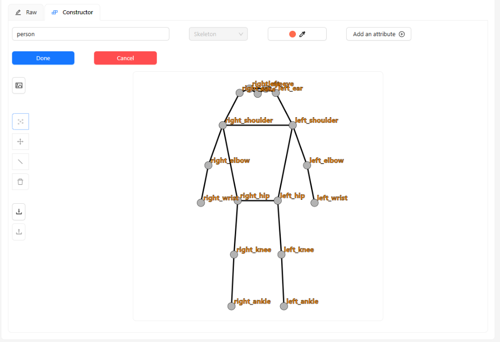
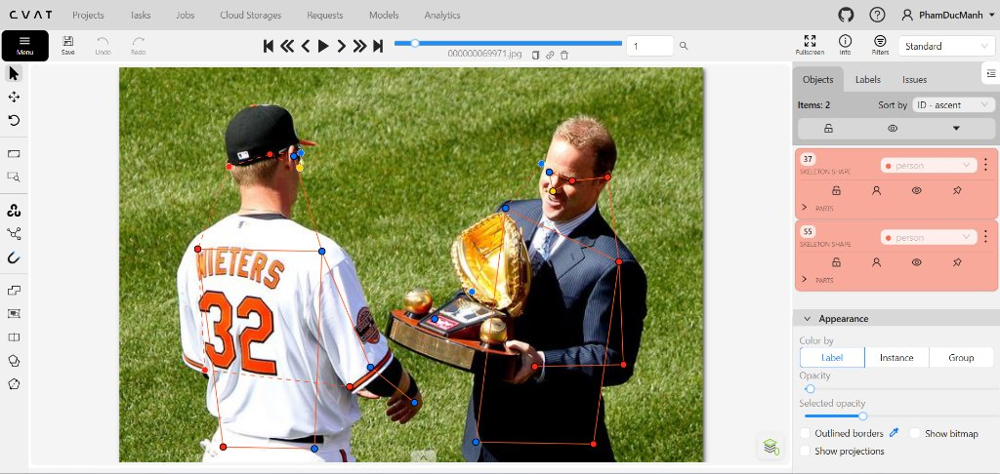
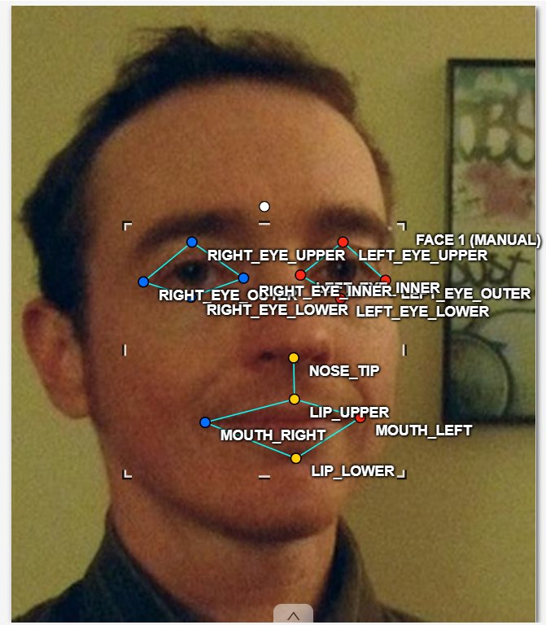
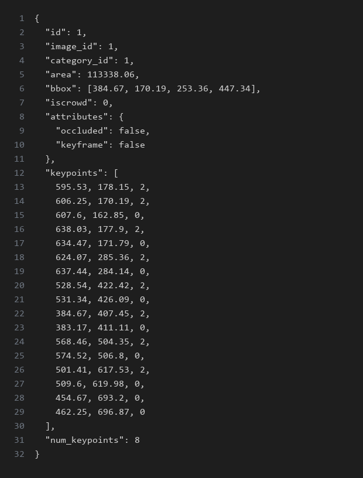

# Báo cáo cá nhân — PhamDucManh-03079

Đổi tên file theo quy tắc `MSSV_HoTen.md`. Ví dụ: `03079_PhamDucManh.md`.

Dữ liệu: 12 ảnh người COCO val2017 (Lin et al., 2014) và 8 ảnh chân dung Wikimedia Commons, chỉ dùng trong lớp.

## 0. Thông tin học viên

- Họ tên: Phạm Đức Mạnh
- MSSV: 03079
- Email: mp01689370315@gmail.com
- Link repository: https://github.com/Payjack123/K5-L2-DAY04-PhamDucManh-03079-KeypointPose
- Phiên bản CVAT (Help → About): 2.74.1
- Máy: hệ điều hành Windows 10/11 · RAM 8 GB · chạy CVAT chế độ lite
- Bộ ảnh (`src/exports/assignment.json` do `lab.py setup` tạo): có
- Giờ bắt đầu: 17:15
- Giờ kết thúc: 19:15

## 1. Kiểm tra label (CP0)

| Label | Kiểu | Số điểm | Tên điểm đúng bảng của lab? | Đúng thứ tự? | Số cạnh |
|---|---|---:|---|---|---:|
| `person` | Skeleton | 17 | Có | Có | 19 |
| `face` | Skeleton | 13 | Có | Có | 13 |

Mẫu `person` dựng theo người quay mặt về camera (các điểm `left_*` nằm bên phải khung mẫu)? Có

Cách đổi cờ `occluded` / `outside` cho **một điểm** trên phiên bản CVAT này (một câu):
Rê chuột vào đúng điểm cần đổi cho điểm sáng lên, bấm phím `Q` để bật/tắt `occluded` (v = 1) hoặc phím `O` để bật/tắt `outside` (v = 0), hoặc click chuột phải vào điểm để chọn menu cờ.

## 2. Số lượng đã gán và thời gian (CP1, CP2)

| Nhóm ảnh | Số ảnh | Số skeleton đã gán | Số người dưới 60 px (không gán) | Số poster / gương / màn hình bỏ qua | Thời gian (phút) |
|---|---:|---:|---:|---:|---:|
| `easy` | 5 | 5 | 0 | 0 | 25 |
| `occluded` | 3 | 6 | 0 | 0 | 20 |
| `back` | 2 | 4 | 0 | 0 | 18 |
| `small` | 1 | 2 | 1 | 0 | 10 |
| `crowd` | 1 | 3 | 2 | 0 | 15 |
| `faces` | 8 | 8 | — | 0 | 25 |

- Số ảnh người đã xong ở mốc phút 105: 10 / 10
- Thời gian thực tế (phút): CP1 73 · CP2 25 · CP3 15
- Ảnh tốn thời gian nhất là ảnh nào, vì sao?
Ảnh `000000309169.jpg` (nhóm crowd) tốn nhiều thời gian nhất vì có nhiều người đứng gần nhau, các chi bị che khuất và chồng chéo, phải lần theo từng khớp từ vai → khuỷu → cổ tay của từng người để tránh nối nhầm xương sang người khác.

## 3. Bảng ca khó (CP1, CP2)

Mỗi điểm bạn phân vân một dòng, nhất là phân vân giữa `v = 1` và `v = 0`, hoặc không chắc hướng người.

| Ảnh | Người / mặt | Điểm | Cờ đã chọn | Phân vân giữa | Lý do chọn |
|---|---|---|---:|---|---|
| `000000056651.jpg` | Người #1 | `left_ankle`, `right_ankle` | 0 | v = 1 và v = 0 | Chân bị cắt ngang mép dưới của ảnh, phần khớp cổ chân nằm ngoài khung ảnh nên chọn outside (v = 0) theo đúng quy tắc |
| `000000069971.jpg` | Cầu thủ #32 | `nose`, `left_eye`, `right_eye` | 0 | v = 1 và v = 0 | Người quay lưng hoàn toàn về phía camera, không thể ước lượng chính xác vị trí mắt mũi nên chọn outside (v = 0) |
| `000000163118.jpg` | Người áo xám #76 | `left_wrist`, `left_elbow` | 1 | v = 1 và v = 0 | Người nhảy quay lưng giơ cao tay phải bắt đĩa bay; tay trái bị thân người che khuất nên phân vân giữa việc ước lượng vị trí cổ tay sau lưng (chọn v = 1) hay để outside (v = 0) khi khuỷu tay trái đã bị che khuất hoàn toàn (v = 0) |
| `face_405456.jpg` | Mặt kính râm | 4 điểm quanh mắt | 1 | v = 1 và v = 2 | Tròng kính râm tối che khuất con ngươi và mí mắt nhưng đoán được vị trí mắt dựa theo khung gọng kính |

## 4. Bảng tự review (CP3)

Đi từ ảnh cuối về ảnh đầu. 5 ảnh người (ít nhất 2 ảnh `back` hoặc `crowd`) và 3 ảnh mặt. Ít nhất 8 dòng, kể cả dòng `ok`. Ghi lỗi trước, sửa sau.

Mã lỗi dùng đúng một trong: `lr_swap`, `vis_flag`, `position`, `missing`, `extra`, `ok`.

| Ảnh | Người / mặt | Điểm | Mã lỗi | Ghi chú | Đã sửa? |
|---|---|---|---|---|---|
| `000000309169.jpg` | Người #1, #2, #3 | Toàn thân | `ok` | Nhóm crowd đã gán đủ 3 người chính ≥ 60 px, không sót người | Đã kiểm tra |
| `000000163118.jpg` | Người nhảy #76 | `wrist`, `ankle` | `ok` | Tư thế nhảy bắt đĩa bay chân tay bắt chéo tự nhiên trong không gian, đã kiểm tra đúng vai → khuỷu → cổ tay | Đã kiểm tra |
| `000000069971.jpg` | Cầu thủ quay lưng | `left_eye`, `right_eye` | `vis_flag` | Ban đầu để v = 2 theo mẫu, sửa sang outside (v = 0) vì quay lưng không thấy mặt | Có |
| `000000056651.jpg` | Người #1 | `left_ankle`, `right_ankle` | `vis_flag` | Điểm ngoài ảnh bị đặt v = 1, sửa thành outside (v = 0) bằng phím O | Có |
| `000000150192.jpg` | Người ngồi bàn ăn #109 | Các điểm chân (`knee`, `ankle`) | `vis_flag` | Chân bị bàn ăn che khuất hoàn toàn, sửa 4 điểm gối và cổ chân sang outside (v = 0); cổ tay và hông bị ly nước/giấy che sửa sang occluded (v = 1) | Có |
| `face_41666.jpg` | Mặt tóc xoăn (nghe điện thoại) | `left_eye_upper`, `mouth_right` | `position` | Lọn tóc rủ xuống che một phần mắt trái khiến điểm mí trên (`left_eye_upper`) ban đầu bị lệch lên tóc, và mép điện thoại che khóe miệng; đã phóng to kéo lại đúng mép mí và khóe môi | Có |
| `face_405456.jpg` | Mặt kính râm | `left_eye_*`, `right_eye_*` | `vis_flag` | Kính râm che mắt, chuyển cờ 4 điểm mắt sang occluded (v = 1) | Có |
| `face_125051.jpg` | Mặt thẳng | `left_eye_upper` | `position` | Mí mắt trên bị lệch 2 px lên lông mày, đã kéo lại đúng mép mí trên con ngươi | Có |

Tổng hợp số lỗi theo mã:

| `lr_swap` | `vis_flag` | `position` | `missing` | `extra` | `ok` |
|---:|---:|---:|---:|---:|---:|
| 0 | 4 | 2 | 0 | 0 | 2 |

Điểm còn phân vân giữa `v = 1` và `v = 0` (ghi cả hai lựa chọn và lý do chọn):
Tại ảnh `000000056651.jpg`, hai cổ chân của người đứng bị mép dưới khung ảnh cắt ngang. Nếu chọn v = 1 thì model sẽ bị phạt vì học điểm ngoài biên; chọn v = 0 (outside) là chính xác theo guideline vì điểm nằm ngoài khung hình không được đoán bừa.

## 5. Kiểm file xuất và kết quả tự kiểm (CP4)

Tự kiểm tay trong file JSON:

| File | Người / mặt kiểm (ảnh, thứ tự) | Số phần tử `keypoints` | Điểm `outside` ra `v = 0`, `occluded` ra `v = 1`? | `num_keypoints` khớp? |
|---|---|---:|---|---|
| `PhamDucManh_persons.zip` | `000000056651.jpg` (#1) | 51 | Có | Có (khớp 15 điểm v > 0) |
| `PhamDucManh_persons.zip` | `000000069971.jpg` (#1) | 51 | Có | Có (khớp 8 điểm v > 0) |
| `PhamDucManh_faces.zip` | `face_125051.jpg` (#1) | 39 | Có | Có (khớp 13 điểm v > 0) |

Sau khi xuất, CVAT ghi `occluded` thành `v = 1` và `outside` thành `v = 0`. Tọa độ của điểm `outside` trong file là `0, 0` hay tọa độ cũ? Tọa độ cũ (CVAT 2.x giữ nguyên tọa độ cũ, điểm v = 0 sẽ tự động bị bỏ qua khi tính loss và OKS).

Hai job đã chuyển sang completed trên CVAT? Có

Dán phần **TÓM TẮT** in ra từ `src/check_submission.py`:

```text
----- TÓM TẮT (dán vào báo cáo mục 5) -----
- File person: PhamDucManh_persons.zip
  Số ảnh: 12 · số skeleton `person`: 20 · mỗi annotation 51 số
  Skeleton theo ảnh: 000000056651=2, 000000069971=2, 000000072098=1, 000000150192=2, 000000163118=2, 000000177889=1, 000000196283=1, 000000309169=3, 000000455536=1, 000000461389=3, 000000516902=1, 000000525227=1
  Cờ v: v=2 263 (77%) · v=1 16 (5%) · v=0 61 (18%)
  num_keypoints trung bình: 13.9
- File face: PhamDucManh_faces.zip
  Số ảnh: 8 · số skeleton `face`: 8 · mỗi annotation 39 số
  Skeleton theo ảnh: face_125051=1, face_145621=1, face_155465=1, face_405456=1, face_41666=1, face_442231=1, face_556064=1, face_575921=1
  Cờ v: v=2 99 (95%) · v=1 5 (5%) · v=0 0 (0%)
  num_keypoints trung bình: 13.0
- Ghi chú: 61 điểm v = 0 vẫn mang tọa độ cũ (CVAT 2.x xuất như vậy; chuẩn COCO ghi 0, 0). Không phải lỗi: điểm v = 0 bị bỏ qua khi huấn luyện và khi chấm.
- Số [LỖI]: 0 · số [CẢNH BÁO]: 4
Kết quả: ĐẠT (đọc lại từng cảnh báo ở trên)
```

Các `[CẢNH BÁO]` còn giữ nguyên và lý do:
Có 4 cảnh báo về cặp wrist / ankle nằm ngược phía ở các ảnh `000000056651.jpg`, `000000163118.jpg`, `000000455536.jpg`. Lý do giữ nguyên: Người trong ảnh đang thực hiện động tác khoanh tay, vắt tay qua người hoặc nhảy bắt đĩa frisbee trên không dẫn đến tay/chân bắt chéo thật so với trục cơ thể. Đã kiểm tra kỹ các đường nối chi khớp (vai → khuỷu → cổ tay, hông → gối → cổ chân) hoàn toàn chính xác theo đúng giải phẫu cơ thể người trong ảnh, không bị đảo trái/phải (`lr_swap`).

## 6. Ảnh chụp màn hình

1. Label `person` trong label constructor (đủ 17 điểm có tên):

   

2. Một người quay lưng đã gán, cờ đã đặt:

   

3. Một khuôn mặt đã gán 13 điểm, phóng to vùng mắt:

   

4. Một đoạn JSON xuất của một người:

   

Nguồn ảnh: COCO val2017 / Wikimedia Commons.

## 7. Tự đánh giá

1. Lỗi bạn mắc nhiều nhất hôm nay, và cách bạn sẽ tránh ở dự án thật:
Lỗi em mắc nhiều nhất lúc đầu là thói quen "cố kéo cho đủ điểm". Khi gặp các khớp nằm ngoài mép ảnh (như 2 cổ chân ở ảnh `000000056651.jpg`) hoặc người ngồi bị khuất chân dưới bàn ăn (`000000150192.jpg`), em vẫn tiện tay để điểm nằm sát mép ảnh và giữ cờ v = 1 hoặc v = 2. Đến khi chạy lệnh export tự kiểm tra bị script bắt lỗi đỏ `[LỖI] điểm ngoài ảnh phải là outside`, em mới nhận ra và bấm phím `O` để chuyển hẳn sang `outside` (`v = 0`). Ở dự án thật, em sẽ tạo phản xạ tự hỏi 4 câu hỏi visibility trước khi lưu: cái gì nằm ngoài ảnh hoặc không thấy chắc chắn thì dứt khoát bật `outside`, tuyệt đối không kéo về mép ảnh cho có.

2. Một quy tắc bạn đề xuất thêm vào guideline (kèm ảnh ví dụ nếu có):
Em đề xuất bổ sung thêm quy ước trực quan cho tình huống "người ngồi sau bàn ăn/bàn làm việc" (như ảnh `000000150192.jpg` em vừa làm): Nên hướng dẫn rõ luôn là toàn bộ chi dưới bị mặt bàn che khuất (gối, cổ chân) bắt buộc chuyển sang `outside` (`v = 0`), tránh việc annotator phân vân cố đoán chân dưới gầm bàn; còn cổ tay hay hông nếu chỉ bị cốc nước hay giấy ăn che một phần nhỏ thì mới để `occluded` (`v = 1`).

3. Nhãn của bạn đi vào model ở đâu? Chọn một lỗi bạn đã sửa và nói nó sẽ làm model học sai thế nào (heatmap, trọng số trong loss, hay bước lật ảnh):
Nhãn keypoint của em sẽ đi vào bước tạo ground-truth heatmap 2D (tạo đỉnh Gaussian tại mỗi vị trí khớp có v > 0) và tính loss function để phạt model khi huấn luyện. 
Ví dụ với lỗi em vừa sửa ở ảnh `000000056651.jpg`: Ban đầu em để 2 cổ chân bị mép ảnh cắt ngang là `v = 1`. Do điểm có `v > 0` đều được tính trọng số bằng 1 trong loss, model sẽ bị ép phải sinh ra một đỉnh heatmap nhân tạo ngay sát mép ảnh, làm model học sai và có xu hướng đoán mò điểm ở những vùng ảnh bị cắt cụt. Sau khi em sửa lại thành `outside` (`v = 0`), điểm đó có trọng số 0 trong loss và không bị tính vào OKS, giúp model không bị phạt oan và không học vẹt vị trí rác.

## 8. Khó khăn và lỗi kỹ thuật

- **Khó khăn khi gán Skeleton người:**
  + *Đảo trái/phải khi người quay lưng:* Mẫu skeleton mặc định trên CVAT là người quay mặt về camera. Khi gán cho người quay lưng (như ảnh `000000069971.jpg` hay `000000163118.jpg`), các điểm `left_*` phải nằm ở bên trái bức ảnh. Ban đầu em rất dễ bị nhầm theo góc nhìn của người xem; phải tập thói quen kéo đổi vị trí toàn bộ các cặp left/right sang đối diện trước rồi mới tinh chỉnh từng khớp.
  + *Xương bị chồng chéo ở ảnh đông người và ca bị che:* Ở ảnh đông người (`000000309169.jpg`) hoặc người ngồi sau bàn ăn (`000000150192.jpg`), các chi của người bị che khuất và dính sát nhau. Em phải phóng to tối đa và lần theo từng đoạn chi (vai → khuỷu → cổ tay, hông → gối → cổ chân) để tránh nối nhầm xương người này sang người khác.
  + *Thao tác đổi cờ từng điểm trên CVAT:* Phải rê chuột thật chuẩn vào đúng chấm điểm cho điểm sáng lên rồi mới bấm phím `Q` (occluded) hoặc `O` (outside). Nếu bấm vội khi chuột chưa trúng điểm thì cờ không nhận, hoặc dễ bấm nhầm phím `H` (hidden) chỉ ẩn tạm trên màn hình chứ không lưu lên server.

- **Khó khăn khi gán Skeleton khuôn mặt:**
  + *Độ chính xác từng pixel ở mí mắt:* Bộ 13 điểm đòi hỏi mí trên và mí dưới phải đặt đúng mép viền mí mắt ngay trên và dưới tâm con ngươi (không được đặt lên lông mi hay lông mày). Ở những ảnh có lọn tóc xoăn che rủ xuống mắt (`face_41666.jpg`) hoặc ảnh chụp góc nghiêng, việc xác định chính xác viền mí mắt rất khó và tốn nhiều thời gian zoom đi zoom lại.
  + *Ước lượng mắt sau kính râm:* Với ảnh đeo kính râm đen (`face_405456.jpg`), tròng kính che kín mắt nên phải căn cứ vào viền gọng kính để ước lượng vị trí mắt và bật cờ `occluded` (`v = 1`), rất dễ phân vân về độ lệch tọa độ.

- **Về kỹ thuật hệ thống:**
  + *Khóa nhãn tránh kéo nhầm:* Khi gán các ảnh có nhiều người đứng cạnh nhau, nếu không khóa (`L`) skeleton đã xong thì lúc kéo điểm người tiếp theo rất dễ bị click nhầm làm xê dịch điểm của người trước. Em đã tập thói quen bấm `L` để khóa cố định ngay sau khi xong một đối tượng.
  + *Lưu dữ liệu và kiểm tra:* Phải bấm `Ctrl+S` thường xuyên sau mỗi người để tránh mất dữ liệu. Khi chạy lệnh export, script tự kiểm tra bắt lỗi tọa độ ngoài ảnh rất chặt chẽ, giúp em rà soát lại đúng các điểm cần bật cờ `outside` trước khi nộp bài.

## 9. Tài liệu tham khảo và công cụ AI đã dùng

...

